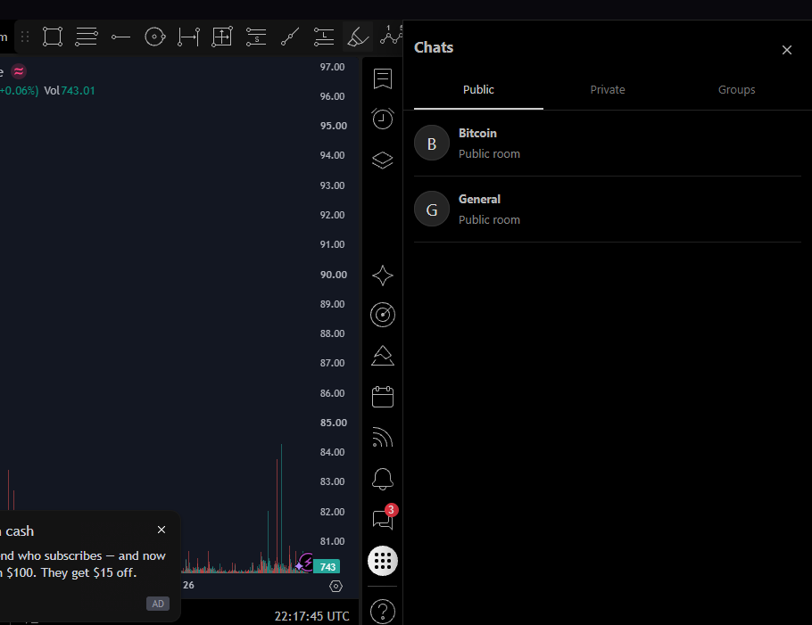
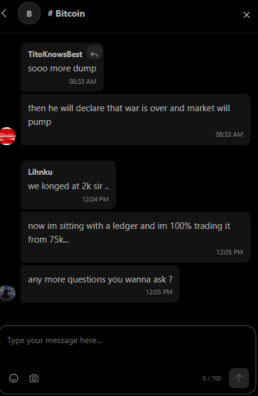
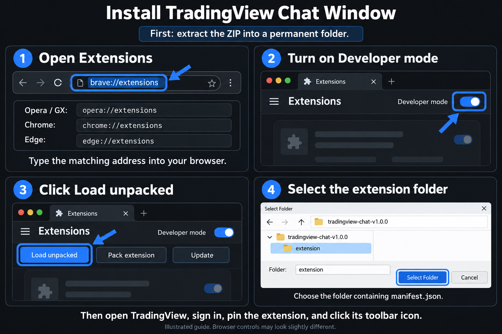

# TradingView Chat Window

An unofficial extension that puts public chats, private chats and groups beside your TradingView chart.

  
  

## Install

1. Download this repository with **Code → Download ZIP**, or download the ZIP from **Releases**.
2. Extract it into a permanent folder.
3. Type the address for your browser into its address bar:

| Browser | Extensions page |
| --- | --- |
| Opera / Opera GX | `opera://extensions` |
| Brave | `brave://extensions` |
| Chrome / Chromium | `chrome://extensions` |
| Edge | `edge://extensions` |
| Vivaldi | `vivaldi://extensions` |

4. Enable **Developer mode**, then click **Load unpacked**.
5. Select the **extension** folder containing `manifest.json`.
6. Open TradingView, sign in, pin the extension and click its toolbar icon. Allow access to TradingView if prompted.

Keep the extracted folder in the same location while installed. Firefox and Safari are not supported.

## Use

- Choose Public, Private or Groups; the last conversation is remembered for each account.
- Type in the composer. Enter sends; Shift+Enter adds a line.
- Use the smile button for emoji or the camera for a native chart snapshot. Wait for its thumbnail, then click Send.
- Click an image to expand it; click the background or press Escape to close it.

For updates, replace the files in the same folder, click **Reload** on the extension card, then reload TradingView. If chart capture fails, check extension site access for TradingView.

Each user uses their own TradingView account. TradingView controls chat access, posting and account restrictions. See [PRIVACY.md](PRIVACY.md) for permissions and data handling.

This project is not affiliated with TradingView. TradingView names and user content belong to their respective owners. The chat screenshots were supplied by the maintainer; the installation picture is an AI-generated illustration. Internal TradingView changes may affect compatibility.
